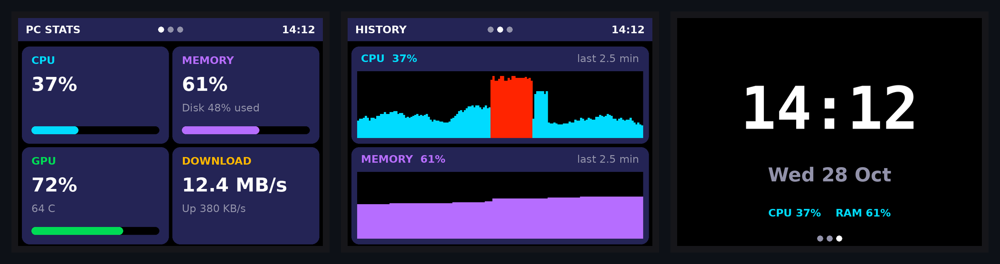

# PC Stats Display

A small desk display that shows live stats from your computer: CPU, memory, GPU, network, disk and the time. A Python script on the PC collects the numbers and streams them over USB serial to a microcontroller, which draws them on a screen.

There are two hardware versions:

| | **CYD Dashboard** | **Nano OLED Ticker** |
|---|---|---|
| Board | ESP32-2432S028 ("Cheap Yellow Display") | Arduino Nano (ATmega328P) |
| Screen | 2.8" 320×240 colour touchscreen | 0.91" 128×32 monochrome OLED |
| Shows | CPU, RAM, GPU + temp, network, disk, history graphs, clock | CPU, RAM, time |
| Extras | Tap to switch pages, RGB LED shows CPU load | — |
| Wiring | None, everything is on the board | 4 wires (I²C) |


<sub>Rendered preview of the three dashboard pages: overview, history graphs and clock.</sub>

## How it works

```
┌──────────────────────┐   USB serial, 115200 baud    ┌────────────────────────┐
│  PC: host script     │  ──────────────────────────► │  Microcontroller       │
│  psutil + nvidia-smi │   one CSV line per second    │  parses line, redraws  │
└──────────────────────┘                              └────────────────────────┘
```

- **Host side (Python):** reads system stats with [`psutil`](https://github.com/giampaolo/psutil), GPU usage and temperature with `nvidia-smi` when an NVIDIA card is present, and network speed by diffing byte counters each second. It finds the board's serial port automatically.
- **Firmware side (C++/Arduino):** buffers serial input into lines, parses the fields, and redraws only when new data arrives. If no data arrives for 5 seconds it falls back to a "Waiting for PC" screen.
- **Flicker-free drawing (CYD):** each frame is drawn into an off-screen 8-bit sprite and pushed to the display in one go.

### Serial protocol

Each version uses one newline-terminated CSV line per second.

**CYD:** `cpu,ram,gpu,gpuTemp,downKBs,upKBs,disk,HH:MM,date`

```
37,61,72,64,12697,380,48,14:12,Wed 28 Oct
```

`gpu` and `gpuTemp` are `-1` when no NVIDIA GPU is found, and the GPU tile then shows "n/a".

**Nano:** `cpu,ram,HH:MM`

```
37,61,14:12
```

Because it's plain text, you can test either display by typing a line into the Arduino Serial Monitor.

## Repository layout

```
firmware/
  cyd_dashboard/cyd_dashboard.ino        ESP32 CYD touchscreen dashboard
  nano_oled_ticker/nano_oled_ticker.ino  Arduino Nano + SSD1306 OLED ticker
host/
  run_dashboard.bat                      Windows launcher for cyd_stats.py
  cyd_stats.py                           PC script for the CYD
  nano_stats.py                          PC script for the Nano
  requirements.txt
docs/                                    Images for this README
```

## Setup: CYD Dashboard

**Hardware:** an ESP32-2432S028 board and a USB cable. Nothing else.

1. In the Arduino IDE, install the **esp32** board package by Espressif (Boards Manager) and the **LovyanGFX** library (Library Manager).
2. Open `firmware/cyd_dashboard/cyd_dashboard.ino`, select **ESP32 Dev Module** and your port, then upload. If the upload stalls on `Connecting...`, hold the **BOOT** button.
3. The screen shows "Waiting for PC..." plus red, green and blue test swatches. If they look wrong, change the settings at the top of the sketch:

   | Symptom | Setting |
   |---|---|
   | White background instead of black | `INVERT_COLORS true` |
   | Red and blue swapped | `SWAP_RED_BLUE true` |
   | Blank screen (single-USB boards) | `PANEL_ST7789 0` (ILI9341 driver) |
   | Upside down | `SCREEN_ROTATION 3` |

4. On the PC:

   ```bash
   cd host
   pip install -r requirements.txt
   python cyd_stats.py          # or: python cyd_stats.py COM5
   ```

   On Windows you can just double-click `host/run_dashboard.bat` instead.

5. Tap anywhere on the screen to cycle through the pages. The onboard LED goes green, yellow or red with CPU load.

## Setup: Nano OLED Ticker

**Hardware:** an Arduino Nano, an SSD1306 128×32 I²C OLED and 4 jumper wires.

| OLED | Nano |
|---|---|
| GND | GND |
| VCC | 5V |
| SCL | A5 |
| SDA | A4 |

1. Install the **Adafruit SSD1306** library, and accept the prompt to also install **Adafruit GFX**.
2. Upload `firmware/nano_oled_ticker/nano_oled_ticker.ino`. Board is **Arduino Nano**. Many clones need processor **ATmega328P (Old Bootloader)** and the CH340 USB driver.
3. Run `python host/nano_stats.py`.

If the OLED stays blank, check that SDA and SCL aren't swapped, then try I²C address `0x3D` in the sketch.

## Troubleshooting

- **Window closes instantly when double-clicked:** usually a missing library. `cyd_stats.py` now stays open and shows the error, along with the exact `pip install` command to fix it.
- **Stuck on "Waiting for the board":** the script lists the ports it can see. If your board is there but not picked up, pass it in, e.g. `python cyd_stats.py COM5` or `/dev/ttyUSB0`. If no ports are listed, try a different USB cable, since some are charge-only.
- **"In use by another program":** close the Arduino Serial Monitor, since only one program can use the port at a time. The script retries automatically.
- **Unplugged the board?** `cyd_stats.py` reconnects by itself when it's plugged back in.
- **GPU shows n/a:** GPU stats currently come from `nvidia-smi`, so they work on NVIDIA cards only.

## Ideas / roadmap

- [ ] Wi-Fi mode: send stats over UDP so the display doesn't need a USB data cable
- [ ] AMD/Intel GPU support (e.g. via LibreHardwareMonitor)
- [ ] CPU temperature and per-core load
- [ ] Now-playing track from Spotify
- [ ] 3D-printed stand

## Built with

- [LovyanGFX](https://github.com/lovyan03/LovyanGFX) for the CYD display and touch
- [Adafruit SSD1306](https://github.com/adafruit/Adafruit_SSD1306) and [Adafruit GFX](https://github.com/adafruit/Adafruit-GFX-Library) for the OLED
- [psutil](https://github.com/giampaolo/psutil) and [pySerial](https://github.com/pyserial/pyserial) on the host

## License

[MIT](LICENSE)
