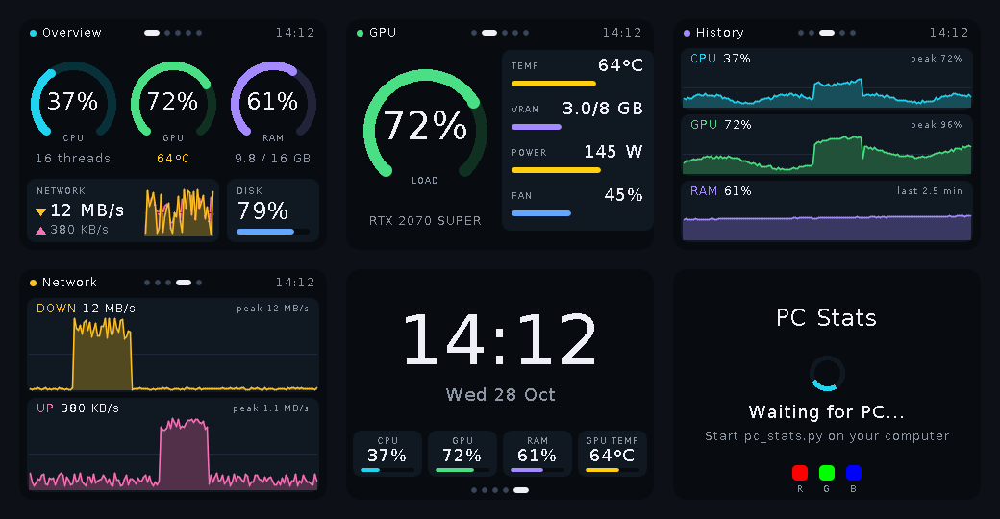
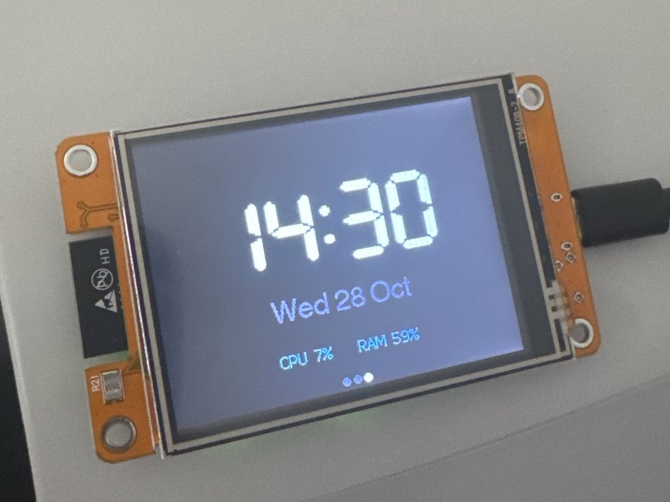

# PC Stats Display

[](https://github.com/flumyzapfe/esp32-pc-stats-checker/actions/workflows/build.yml)


[](LICENSE)

A small desk display that shows live stats from your computer: CPU, memory, GPU, network, disk and the time.

A Python script on the PC collects the numbers and streams them over USB to a microcontroller, which draws them on its screen. The main build runs on a £10 ESP32 touchscreen board and needs **no soldering and no wiring**.


<sub>Rendered from the actual firmware drawing code by [tools/ui_preview](tools/ui_preview), using sample data.</sub>

<p align="center">
  
</p>

## Features

- **Five pages:** overview gauges, GPU details, CPU/GPU/RAM history, network graphs and a clock. Tap the right side of the screen to go forward and the left side to go back. The page is remembered after a restart.
- **NVIDIA GPU details:** load, temperature, VRAM, power draw and fan speed, read through NVIDIA's driver library (NVML)
- **Smooth animation:** gauges and bars glide to each new reading instead of jumping
- **Full-colour, anti-aliased graphics** without flicker, drawn in strips so a full frame fits in the ESP32's limited RAM
- **Plug and play:** the PC script finds the board automatically, waits if it isn't plugged in, and reconnects if it's unplugged
- **Status LED** glows green, yellow or red with CPU load, and the screen dims when the PC goes away
- **Windows launcher** that installs the Python dependencies on first run
- **Second, smaller build** for an Arduino Nano with a 0.91" OLED

## Quick start

You need an **ESP32-2432S028** ("Cheap Yellow Display") board, a USB data cable, the [Arduino IDE](https://www.arduino.cc/en/software) and [Python 3.9+](https://www.python.org/downloads/).

**1. Download the project.** Click the green **Code** button above, then **Download ZIP**, and unzip it. Or use git:

```bash
git clone https://github.com/flumyzapfe/esp32-pc-stats-checker.git
```

**2. Put the dashboard on the board.**

1. In the Arduino IDE, open **Boards Manager**, search `esp32` and install **esp32 by Espressif Systems**.
2. Open **Library Manager**, search `LovyanGFX` and install it.
3. Open `firmware/cyd_dashboard/cyd_dashboard.ino`.
4. Select board **ESP32 Dev Module** and your board's port, then click **Upload**. If it stalls on `Connecting...`, hold the **BOOT** button on the back of the board.

The screen should then say **Waiting for PC...**

**3. Start the PC side.**

- **Windows:** double-click `host/run_dashboard.bat`. The first time, it installs the Python libraries it needs.
- **macOS / Linux:**
  ```bash
  cd host
  pip install -r requirements.txt
  python3 pc_stats.py
  ```

The dashboard comes alive within a couple of seconds. Tap the right or left side of the screen to switch pages.

## Hardware

| | **CYD Dashboard** (main build) | **Nano OLED Ticker** |
|---|---|---|
| Board | ESP32-2432S028 "Cheap Yellow Display" | Arduino Nano (ATmega328P) |
| Screen | 2.8" 320×240 colour touchscreen | 0.91" 128×32 monochrome OLED |
| Shows | CPU, memory, disk, GPU (load, temp, VRAM, power, fan), network, history graphs, clock | CPU, memory, time |
| Wiring | None, everything is on the board | 4 jumper wires |
| Approx. cost | ~£10–15 | ~£5 |

### Display settings (CYD)

CYD boards are sold in a few variants. The start screen shows red, green and blue test swatches, so you can tell straight away if anything needs changing. If it does, edit the settings at the top of `cyd_dashboard.ino` and re-upload:

| What you see | Setting to change |
|---|---|
| White background instead of black | `INVERT_COLORS` → `true` |
| The "R" swatch looks blue | `SWAP_RED_BLUE` → `true` |
| Blank screen (common on single-USB boards) | `PANEL_ST7789` → `0` (uses the ILI9341 driver) |
| Upside down | `SCREEN_ROTATION` → `3` |
| Tapping right goes back instead of forward | `TOUCH_FLIP_X` → `true` |

The defaults work on the dual-USB (USB-C + micro-USB) board shown in the photo.

### Nano OLED Ticker

| OLED pin | Nano pin |
|---|---|
| GND | GND |
| VCC | 5V |
| SCL | A5 |
| SDA | A4 |

1. Install the **Adafruit SSD1306** library, and accept the prompt to also install its dependencies.
2. Upload `firmware/nano_oled_ticker/nano_oled_ticker.ino` with board **Arduino Nano**. Many clone boards need processor **ATmega328P (Old Bootloader)** and the CH340 USB driver.
3. Double-click `host/run_nano_ticker.bat`, or run `python pc_stats.py --board nano`.

## How it works

```
+-------------------------+   USB serial, 115200 baud    +-------------------------+
|  PC: host/pc_stats.py   | ---------------------------> |  ESP32 / Arduino        |
|  psutil + NVML          |   one text line per second   |  parse line -> redraw   |
+-------------------------+                              +-------------------------+
```

**PC side (`host/pc_stats.py`)**
- `StatsCollector` reads CPU, memory and disk with [psutil](https://github.com/giampaolo/psutil). It works out network speed from the change in byte counters since the last reading.
- `GpuReader` reads NVIDIA GPU load, temperature, VRAM, power and fan speed through NVML ([nvidia-ml-py](https://pypi.org/project/nvidia-ml-py/)). If that isn't available it falls back to `nvidia-smi`. Anything the card doesn't report is left out, and the screen shows it as "--".
- Each board has a small formatter function that turns a reading into its line format.
- The main loop finds the board's USB-serial port by name (CH340, CP210x and so on), sends a line every second, and reconnects if the board disappears.

**Board side (`firmware/cyd_dashboard/`)**

The CYD firmware is split so that only one file touches the hardware:

| File | Job |
|---|---|
| `cyd_dashboard.ino` | Display, touch and backlight setup, serial input, the main loop |
| `dashboard_data.h` | The stats model, history ring buffers and the protocol parser. Plain C++, no hardware. |
| `dashboard_ui.h` | Everything that gets drawn: theme, widgets (ring gauges, bars, area graphs) and the five pages |

- **Rendering:** a full 320×240 frame at 16-bit colour needs 150 KB, more than the ESP32 has free in one block. So each frame is drawn twice into a 320×120 sprite (75 KB), once per half of the screen, and each half is pushed to the display in one go. Pages draw through a `Canvas` that shifts coordinates into the current strip, so page code never has to know about strips.
- **Animation:** displayed values move a fraction of the way to the latest reading on each frame (about 30 fps), and the screen only redraws while something is changing.
- **Robustness:** serial input goes into a fixed 256-byte line buffer, and invalid lines are dropped. If no data arrives for 5 seconds, the display goes back to the "Waiting for PC" screen, and it dims after a minute.

Because the drawing code doesn't depend on the hardware, [tools/ui_preview](tools/ui_preview) builds it on a normal PC with LovyanGFX's desktop back end and renders each page to PNG. The screenshots above come from it, and CI runs it on every push.

### Serial protocol

Both boards use plain text, so you can test a display without the PC script by typing a line into the Arduino Serial Monitor (115200 baud, newline line ending).

**CYD:** comma-separated `key=value` pairs. The firmware ignores keys it doesn't know and treats missing keys as unknown, so new stats can be added on one side without breaking the other. Only `cpu` is required.

```
cpu=37,cpun=16,ram=61,ramu=9984,ramt=16310,gpu=72,gput=64,vram=3120,vramt=8192,gpw=145.5,gpwl=215,fan=45,dn=12697,up=380,disk=48,t=14:12,d=Wed 28 Oct,gn=RTX 2070 SUPER
```

| Key | Meaning | Key | Meaning |
|---|---|---|---|
| `cpu` | CPU load % | `gpw` / `gpwl` | GPU power draw / limit, W |
| `cpun` | CPU threads | `fan` | GPU fan % |
| `ram` | Memory used % | `dn` / `up` | Network down / up, KB/s |
| `ramu` / `ramt` | Memory used / total, MB | `disk` | System drive used % |
| `gpu` | GPU load % | `t` | Time, `HH:MM` |
| `gput` | GPU temperature, °C | `d` | Date text |
| `vram` / `vramt` | VRAM used / total, MB | `gn` | GPU name |

The original positional format (`cpu,ram,gpu,gpuTemp,down,up,disk,HH:MM,date`) is still accepted.

**Nano:** `cpu,ram,HH:MM`, e.g. `37,61,14:12`

## Host script options

```
python pc_stats.py [--board {cyd,nano}] [--port PORT] [--list-ports]

  --board        which display you're using (default: cyd)
  --port         serial port, e.g. COM5 or /dev/ttyUSB0 (default: auto-detect)
  --list-ports   list serial ports and exit
```

The Windows launchers pass extra options through, e.g. `run_dashboard.bat --port COM5`.

## Adding your own stat

As an example, here's how to show the number of running processes (`len(psutil.pids())`). Because the protocol uses named keys, each side is a small, separate change.

1. **PC side:** add a `procs` field to the `Stats` dataclass in `host/pc_stats.py`, fill it in `StatsCollector.read()`, and add `("procs", s.procs)` to the list in `format_cyd()`.
2. **Board side:** add `float procs;` to `Metrics` in `dashboard_data.h` (and set it to `-1` in `clear()`), then add `{"procs", &Metrics::procs}` to the key table in `setField()`.
3. **Draw it** in one of the page functions in `dashboard_ui.h`, then check how it looks by running `tools/ui_preview`. You don't need to upload anything to do that.
4. Update `test_all_fields` in `host/test_pc_stats.py`.

## Troubleshooting

| Problem | Fix |
|---|---|
| Window says "Python was not found" | Install Python from python.org and tick **Add python.exe to PATH** in the installer. |
| Stuck on "Waiting for the board" | Check the board is plugged in and has the dashboard uploaded. If no ports are listed, try another cable, since some only charge. If your board is listed but not picked up, use `--port COMx`. |
| "In use by another program" | Close the Arduino IDE's Serial Monitor. Only one program can use the port at a time. |
| GPU tile shows "n/a" | The startup message says whether a GPU was found. GPU stats need an NVIDIA card with its driver installed. |
| Upload stalls on `Connecting...` | Hold the **BOOT** button on the board until the upload starts. |
| Upload fails with "Could not open COMx... Access is denied" | The PC script is still using the port. Close its window, upload, then start it again. |
| Colours or orientation look wrong | See [Display settings](#display-settings-cyd). |

## Project structure

```
firmware/
  cyd_dashboard/
    cyd_dashboard.ino                    ESP32 CYD: hardware setup, serial, main loop
    dashboard_ui.h                       Drawing: theme, widgets, pages
    dashboard_data.h                     Stats model, history, protocol parser
  nano_oled_ticker/nano_oled_ticker.ino  Arduino Nano + SSD1306 OLED ticker
host/
  pc_stats.py                            PC script: collects stats, talks to the board
  test_pc_stats.py                       Unit tests (python -m unittest)
  run_dashboard.bat                      Windows launcher for the CYD
  run_nano_ticker.bat                    Windows launcher for the Nano
  requirements.txt
tools/ui_preview/                        Builds the UI on a PC: renders screenshots, C++ tests
docs/                                    Images for this README
.github/workflows/build.yml              CI: compiles, tests, renders screenshots
```

## Testing

Every push is checked by [GitHub Actions](.github/workflows/build.yml):
- **Firmware:** both sketches are compiled with `arduino-cli`, for the ESP32 and for the AVR Nano.
- **Host:** the Python unit tests run on Linux and Windows with Python 3.9 and 3.13. They cover the line formats, the firmware's buffer limit, and GPU detection with a simulated NVIDIA card, including the NVML and `nvidia-smi` paths and unsupported values.
- **Protocol:** C++ tests check the firmware's parser on valid, legacy, partial, malformed and over-long input. A line produced by the Python script is then piped into that same parser, so both sides are checked against each other.
- **UI:** every page is rendered to PNG. The images are attached to each run as a download.

To run them locally:

```bash
# Python tests
cd host && python -m unittest -v

# C++ protocol tests and screenshots (needs CMake and a C++17 compiler)
cd tools/ui_preview
git clone --depth 1 --branch 1.2.35 https://github.com/lovyan03/LovyanGFX.git
cmake -S . -B build && cmake --build build -j
./build/test_protocol
./build/ui_preview .          # writes screen_*.png
```

## Roadmap

- [ ] Wi-Fi mode: send stats over UDP so the display only needs power
- [ ] AMD/Intel GPU support (e.g. via LibreHardwareMonitor)
- [ ] Per-core CPU load and CPU temperature
- [ ] Touch-adjustable screen brightness and a night mode for the clock page
- [ ] 3D-printed stand

## Built with

- [LovyanGFX](https://github.com/lovyan03/LovyanGFX) for the CYD display and touch
- [Adafruit SSD1306](https://github.com/adafruit/Adafruit_SSD1306) and [Adafruit GFX](https://github.com/adafruit/Adafruit-GFX-Library) for the OLED
- [psutil](https://github.com/giampaolo/psutil), [pySerial](https://github.com/pyserial/pyserial) and [nvidia-ml-py](https://pypi.org/project/nvidia-ml-py/) on the PC

## License

[MIT](LICENSE)
